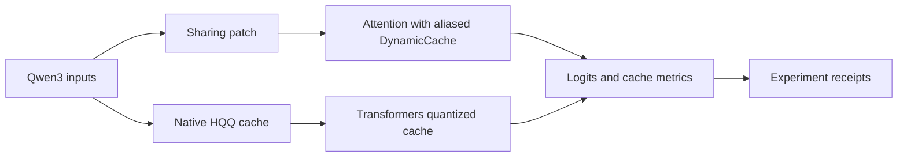
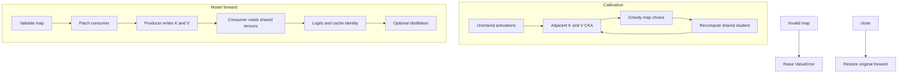

# KV cache sharing

An executable implementation of adjacent inter-layer KV sharing and consumer-only self-distillation for pretrained Qwen3. It runs actual PyTorch attention and aliases actual Transformers cache storage. It is not an array simulator.

## Contents

- [Native HQQ cache study](#native-hqq-cache-study)
- [Run](#run)
- [Architecture and execution guide](#architecture-and-execution-guide)
- [Course and mechanism map](#course-and-mechanism-map)
- [Observed local result](#observed-local-result)
- [Verification and limits](#verification-and-limits)
- [License and provenance](#license-and-provenance)

## Architecture and execution guide

This project has two real-model paths. `Sharing` patches adjacent attention consumers and aliases actual Transformers cache objects; calibration selects a map and optional distillation trains consumer parameters. The separate HQQ study uses Transformers' native quantized cache. A [producer layer](#producer-layer) supplies K/V; a [consumer layer](#consumer-layer) reuses it.

The top-level flow separates patched sharing from native HQQ measurements.



Calibration recomputes student activations after each selected pair. The sharing flow rejects invalid maps and `close` restores the original attention methods.



| Subsystem | Responsibility and owned state | Source |
| --- | --- | --- |
| Map validation and patch | Checks map shape and saves/restores patched attention methods. | [`kvshare.py`](kvshare.py) |
| Calibration | Computes post-RoPE adjacent K/V activations, scores them, and greedily selects a map. | [`kvshare.py`](kvshare.py) |
| Cache sharing | Skips consumer K/V projections and aliases producer entries in `DynamicCache`. | [`kvshare.py`](kvshare.py), [`test_sharing.py`](tests/test_sharing.py) |
| Distillation and metrics | Selects trainable consumer parameters and reports loss, KL, cache bytes, and Pareto status. | [`kvshare.py`](kvshare.py) |
| HQQ receipts | Measures native quantized cache behavior on fixed blocks. | [`quantized_metrics.py`](tools/quantized_metrics.py), [`check_hqq_receipts.py`](tools/check_hqq_receipts.py) |
| Verification | Drives bounded model checks without implicit weight downloads. | [`verify.py`](tools/verify.py), [`test_sharing.py`](tests/test_sharing.py) |

Execution journey:

1. Load local Qwen3 weights and prepare input IDs and masks.
2. `calibrate` scores adjacent [linear CKA](#linear-cka) for keys and values, then recomputes the shared student before choosing the next pair.
3. Validate the map. Chains, fan-out, and invalid windows raise `ValueError`.
4. `Sharing` patches consumer attention. The producer writes K/V and the consumer reads those same cache tensors without its own projections.
5. Run inference or consumer-only distillation. Tests verify object identity and prefill/decode parity. Call `close` to restore attention.
6. HQQ uses a separate native cache path and records fixed-input quality and storage; it does not use the sharing patch.

| Choice | Current behavior and rationale inferred from code | Alternative and cost to reconsider |
| --- | --- | --- |
| Restrict maps to adjacent layers | Avoids chains and fan-out and reuses the preceding layer's tensors. | Arbitrary graphs need compatibility and cache ownership rules. |
| Use minimum K/V CKA | Both key and value activations must score well. | Learned scoring is task-specific and needs training and validation. |
| Recompute after each greedy choice | Later scores reflect the changed student forward. | One-shot ranking is cheaper but evaluates under a stale path. |
| Alias actual cache objects | Avoids tensor copies and measures real cache storage reduction. | Copies keep layers independent but remove the sharing benefit. |
| Train selected consumer parameters | Leaves teacher and producer weights fixed. | Full tuning adds compute and changes unrelated model parameters. |
| Measure HQQ separately | Keeps quantization effects distinct from layer sharing. | Combining mechanisms confounds their individual quality and storage effects. |

These are current tradeoffs, not recorded historical intent. Fixed-input results do not establish generated-text quality, throughput, or total GPU memory savings.

<a id="producer-layer"></a>

<details><summary>What is a producer layer?</summary>

A producer layer computes the K/V tensors a consumer reuses. The test map `{1: 0}` makes layer 0 the producer for layer 1.

</details>

<a id="consumer-layer"></a>

<details><summary>What is a consumer layer?</summary>

A consumer layer reads the preceding producer's K/V tensors instead of projecting its own. The patch leaves its other attention work in place.

</details>

<a id="linear-cka"></a>

<details><summary>What is linear CKA?</summary>

Linear centered kernel alignment compares feature relationships after centering activations. Calibration scores post-RoPE keys and values separately and takes the lower score.

</details>

<a id="dynamic-cache"></a>

<details><summary>What is DynamicCache?</summary>

`DynamicCache` is Transformers' per-layer growing KV cache. Tests confirm producer and consumer entries can be the same object through prefill and decode.

</details>

<a id="teacher-forced-metric"></a>

<details><summary>What is a teacher-forced metric?</summary>

A teacher-forced metric scores fixed tokens instead of sampled text. The HQQ report uses held validation blocks, so it does not establish generated-text quality.

</details>

## Native HQQ cache study

On 256 held WikiText-2 validation blocks, the selected native Transformers HQQ 8-bit cache had mean whole-block NLL increase `0.0006791` and teacher KL `0.0018341`. The corresponding decode means were `0.0013689` NLL increase and `0.0036682` KL, below the study's `0.02` mean gates. At batch size four and sequence length 128, measured persistent cache storage was 31,195,136 bytes versus 58,720,256 bytes for the identity cache, a 46.875% reduction. These are fixed-input teacher-forced means; some individual blocks exceeded the NLL threshold. This does not establish equivalence, generated-text quality, throughput, total GPU memory savings, training improvement, or a new quantizer. See the [full HQQ report and receipts](docs/results/hqq-cache-2026-10-24.md).

## Run

Python 3.11+, `requirements.txt`. The tested Windows environment uses Python 3.11.9, PyTorch 2.11.0+cu128, Transformers 5.20.2, safetensors 0.8.0 and huggingface-hub 2.2.0. No dependency changes were made to that environment.

```powershell
$python = 'C:/Users/steve/.codex/tools/coursework-ml/Scripts/python.exe'
& $python tools/verify.py doctor
& $python tools/verify.py drive
& $python tools/verify.py pretrained
```

The last command requires locally cached public `Qwen/Qwen3-0.6B` safetensors at revision `c1899de289a04d12100db370d81485cdf75e47ca` and exclusive CUDA access. It never downloads model files or executes remote Python. On another machine, prepare that public revision separately, then run the same commands with your Python executable. CPU tests need no weights, tokens, account or network.

The underlying command is `python -m kvshare experiment --device cuda --steps 4 --pairs 2 --output evidence/pretrained.json`. Steps are bounded to 1..20 and pairs to 1..4 for this small experiment. The verification driver imposes a 600-second process timeout; the training loop also checks a 540-second budget. Use the driver for the full bounded run.

Outputs are `evidence/pretrained.json`, driver transcripts and an ignored `checkpoints/consumer.safetensors` containing only trainable consumer parameters. Every run replaces that local checkpoint. No persistent service is started. Process exit releases GPU allocations and leaves the evidence intact. The recorded CUDA result, including raw generations, is retained in [docs/results/pretrained-2026-10-21.json](docs/results/pretrained-2026-10-21.json).

## Course and mechanism map

[Berkeley CS262A Fall 2025 gallery](https://people.eecs.berkeley.edu/~kubitron/cs262a/projects.html) links Ray Wan and Keagan Chern's [KVAlign report](https://people.eecs.berkeley.edu/~kubitron/courses/cs262a-F25/projects/reports/project1007_paper_35544340631323499427.pdf). This project implements those mechanisms with original integration code and official Transformers primitives. No complete student implementation with verified reusable rights was available, so no student source was copied.

| Report concept | Code and actual behavior |
|---|---|
| Sections 4.2–4.3 linear CKA | `cka`, `calibrate` flatten actual post-RoPE key/value activations over batch and sequence, remove padding, center features and use the minimum of K-CKA and V-CKA. Gram computation is algebraically equivalent to linear CKA. |
| Section 4.4 iterative map | Re-run the currently shared student after every greedy choice, score remaining adjacent pairs, select consumer → previous producer. Validation rejects chains and fan-out. Selection preserves enough remaining adjacency capacity to fill the requested map, an additional constraint for dense maps. |
| Actual sharing | `Sharing` skips consumer K/V projections and reads producer tensors. With DynamicCache, producer and consumer layer entries are the same object; producers update once per forward. |
| Section 4.5 trainable subset | Only consumer query projection, query norm, block layer norms and MLP train. K/V/output projections, unused key norm, other layers, embeddings and head remain frozen. |
| Section 4.5 objective | `T² KL(teacher || student) + α hidden_MSE`, T=2 and α=0.1. A frozen pretrained teacher supplies logits and intermediate hidden state 27 in the recorded run. Padding is excluded. |
| Original extension | Compare independent, uniform adjacent, CKA, consumer-window-8 and distilled CKA on a disjoint synthetic held-out fixture. Report token agreement, next-token NLL, teacher KL and allocated unique KV storage; mark the memory/KL Pareto frontier. |

The report does not specify consumer window truncation. The optional `Sharing(..., window=8)` is an original causal attention-mask ablation. It masks old history for consumers while keeping the producer's full cache, so it provides no further storage saving. Each consumer query gets its own window during both prefill and decode. It is not presented as a KVAlign paper result.

## Observed local result

One final bounded run on 2026-10-21, RTX 5080 Laptop GPU, BF16, two calibration strings, four training strings and two separate held-out strings in `fixtures.json`. Sequence length is capped at 48 tokens. Selection chose layers 26→25 and 22→21, using zero-based indices. Four optimizer steps changed a consumer parameter by a maximum of 0.0001220703125. There are 23,073,024 trainable parameters. All teacher gradients remained absent.

| Policy | Unique KV bytes | Teacher KL | Next-token NLL | Token agreement |
|---|---:|---:|---:|---:|
| Independent | 3,440,640 | approximately 0 | 3.728292 | 1.000000 |
| Uniform adjacent | 3,194,880 | 0.897086 | 4.383054 | 0.500000 |
| CKA | 3,194,880 | 0.752537 | 4.913283 | 0.678571 |
| CKA window 8 | 3,194,880 | 0.812607 | 5.031155 | 0.678571 |
| CKA distilled | 3,194,880 | 0.738309 | 4.906075 | 0.678571 |

Unique storage fell by 245,760 bytes, or 7.14% (2 of 28 layers). Byte accounting deduplicates `untyped_storage` pointers; it includes allocated padded positions and excludes model weights, attention temporaries and allocator reserve. Peak CUDA allocation for the whole experiment was 2,697,165,824 bytes. Timing is only a diagnostic, not a speed measurement. Tiny floating-point KL error makes the baseline approximately -6e-9 in raw JSON.

Distillation slightly reduced fixture teacher KL and NLL relative to untrained CKA, but both remained worse than the original model. Uniform sharing has better NLL than CKA here despite worse teacher KL. The Pareto marker uses memory and teacher KL only and does not imply dominance on all quality measures. Generation is actually executed for both teacher and distilled student and retained in JSON. It is not asserted to be correct or fluent.

A completed [Trainer/WikiText2 study](.agents/skills/verify-kv-cache-sharing/features/metrics.md) ran all 30 frozen candidates: five seeds, uniform/CKA maps, one/two/four pairs and 256 updates each, with consumer checkpoints at 32/128/256. Calibration, optimization and validation used separate blocks of the official splits. All candidates passed exact checkpoint/validation replay and actual alias-byte checks; **none passed the quality gate**. Across five seeds, validation medians [range] were:

| Policy / pairs | Paired NLL increase, nats/token | Teacher KL, nats/token | Cache reduction |
|---|---:|---:|---:|
| Uniform / 1 | 0.3864 [0.3835–0.3953] | 0.5122 [0.5082–0.5196] | 3.57% |
| Uniform / 2 | 0.6253 [0.6070–0.6287] | 0.7596 [0.7425–0.7624] | 7.14% |
| Uniform / 4 | 1.4402 [1.4201–1.4653] | 1.5880 [1.5712–1.6142] | 14.29% |
| CKA / 1 | 0.2486 [0.2474–0.2499] | 0.2639 [0.2626–0.2642] | 3.57% |
| CKA / 2 | 0.4092 [0.4075–0.4131] | 0.4038 [0.4023–0.4056] | 7.14% |
| CKA / 4 | 0.9450 [0.9409–0.9490] | 0.9636 [0.9587–0.9662] | 14.29% |

The fixed paired-NLL limit of 0.02 nats/token is an engineering target of about 2.02% relative perplexity. KL 0.02 is a separate unvalidated drift budget. Neither establishes statistical equivalence, lossless sharing or downstream task quality. The untouched validation baseline was NLL 3.510527 and 14,680,064 unique cache bytes. The observed byte savings therefore come with quality degradation.

Selection chose **identity/no-sharing for all five seeds before any test evaluation**. Each then evaluated every one of the 2,336 official test blocks: selected NLL 3.9101173804 versus baseline 3.9101173898, 100% teacher-forced argmax token agreement and **zero cache saving**. These repeat the same original model/corpus rather than provide independent test-data samples. Raw mean KL is -2.378e-9 and paired NLL difference -9.339e-9; signed roundoff is retained. A fixed-input CPU control reproduced differences between the existing NLL reduction paths. The earlier external bitwise-NLL audit failure is preserved; it does not change the quality gate or prove bitwise equality of model logits.

[All candidate/seed metrics, checkpoint hashes, source/model/data identities and receipt hashes](docs/evidence/wikitext-metrics-20261022/summary.json) retain the complete result. The RTX 5080 Laptop GPU runtime used pinned Qwen3-0.6B BF16 eager attention, Torch 2.11.0+cu128, Transformers 5.20.2, Accelerate 1.15.0 and Datasets 5.1.0. Peak CUDA allocation was 3,567,999,488 bytes for training and 1,799,724,032 for final evaluation. Final processes took 150.781–161.312 seconds each under 600-second caps, with owned-process cleanup confirmed; these are diagnostic costs, not throughput results. The [measurement contract and commands](.agents/skills/verify-kv-cache-sharing/features/metrics.md) record the pinned WikiText revision/license, exact split roles and frozen selection/test boundaries. No compression-speedup or downstream task result is claimed.

## Verification and limits

Twenty-seven CPU tests pass in the installed study environment, including the published HQQ receipt check, relocation and tampering regressions, and CPU HQQ schedule tests. The maintained coursework environment passes 24 tests and skips three optional HQQ backend tests. The GitHub Actions workflow runs the maintained `doctor` and `drive` commands, but no remote CI result was checked for this publication change. Local `compileall` is the syntax check; no project linter or type checker existed to reuse.

The public library currently supports this pinned Qwen3 eager-attention API and greedy generation with DynamicCache. Beam cache reordering, static/offloaded caches, distributed serving, other model families and compiled attention are unverified. The window ablation retains full producer storage. Student K/V weights remain loaded but are not computed for consumers; the saving measured here is KV state, not model-weight compression.

This small 0.6B synthetic smoke experiment does not reproduce the paper's 8B/14B models, long contexts, benchmark suite, corpus or H200 training. It establishes real execution and weight updates, not preserved general accuracy, production readiness or throughput improvement. Fixture contents are owned synthetic examples. There is no paid API or cloud work.

The supplied environment has a known `torch.jit.script` advisory, GHSA-rrmf-rvhw-rf47. This experiment does not use `torch.jit.script`, untrusted pickle checkpoints or remote model code. The environment was retained under the explicit task exception; this is not a claim that all installed dependencies are vulnerability-free.

## License and provenance

Code is Apache-2.0; see `LICENSE` and `NOTICE`. The attention adapter follows the inspected [official Qwen3 module](https://github.com/huggingface/transformers/blob/v5.20.2/src/transformers/models/qwen3/modeling_qwen3.py), also Apache-2.0. PyTorch is BSD-3-Clause; Transformers, safetensors and huggingface-hub are Apache-2.0. [The pinned Qwen weight license](https://huggingface.co/Qwen/Qwen3-0.6B/blob/c1899de289a04d12100db370d81485cdf75e47ca/LICENSE) is Apache-2.0. Weights are not vendored. The course report is cited for ideas, without assuming rights to redistribute student code.
