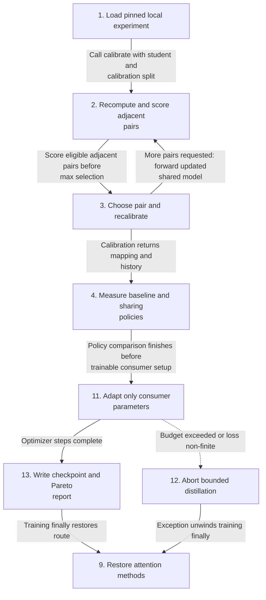
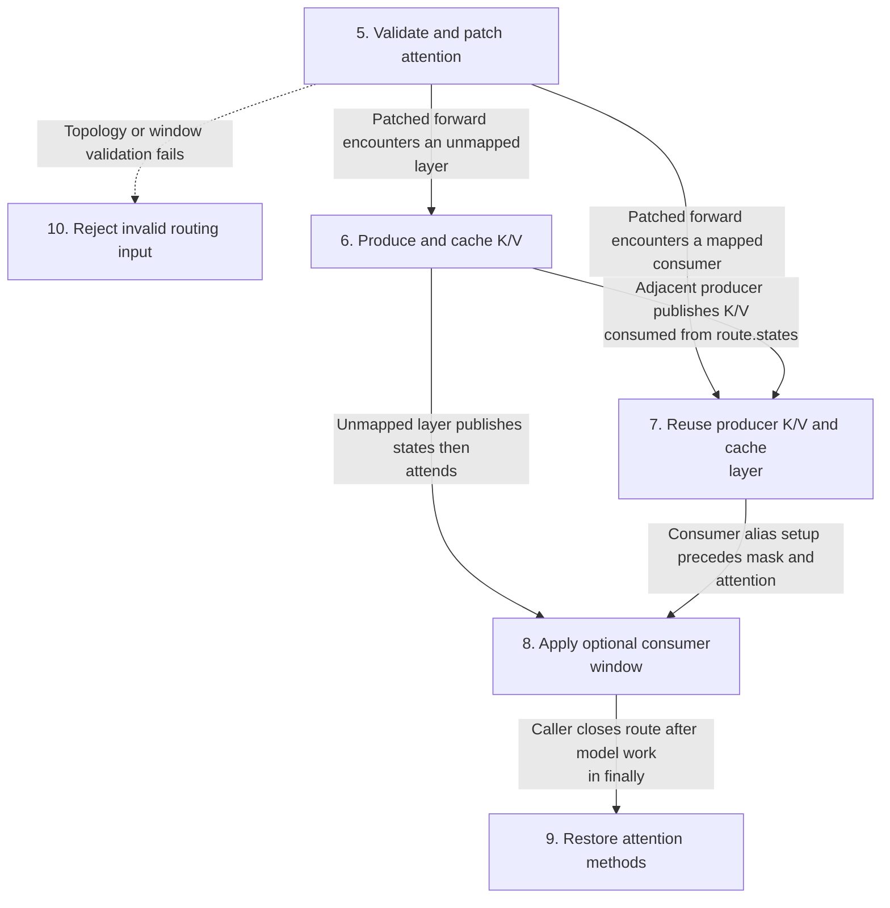
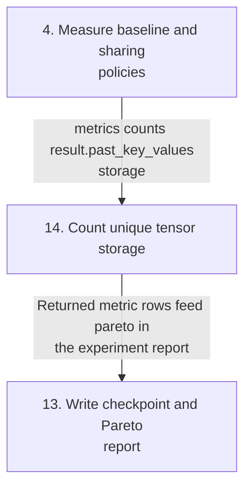
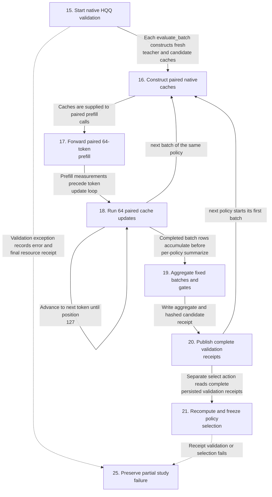
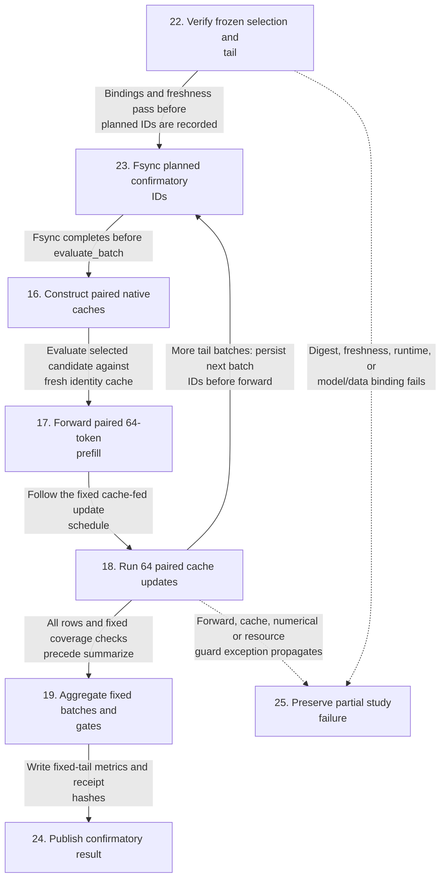
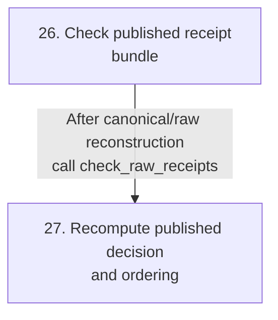
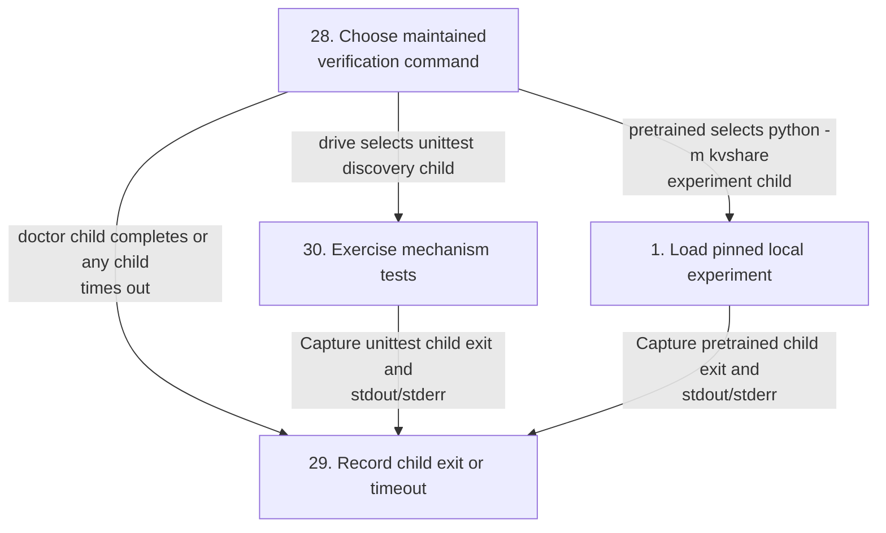
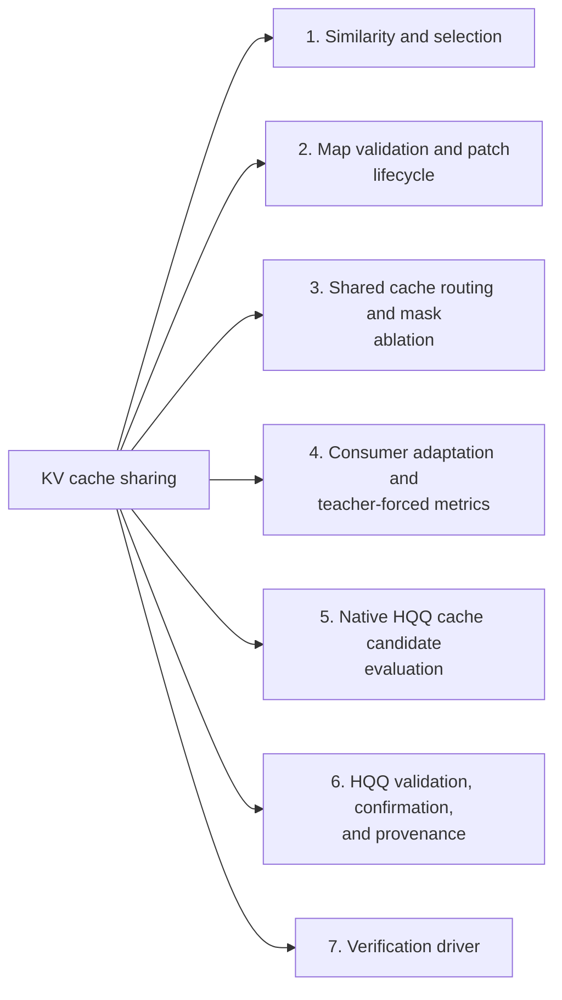
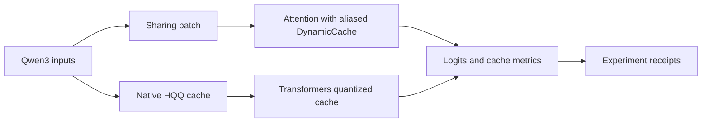
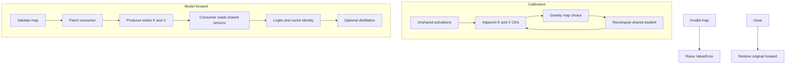

# KV cache sharing

An executable implementation of adjacent inter-layer KV sharing and consumer-only self-distillation for pretrained Qwen3. It runs actual PyTorch attention and aliases actual Transformers cache storage. It is not an array simulator.

## Contents

- [Implementation techniques](#implementation-techniques)
- [Native HQQ cache study](#native-hqq-cache-study)
- [Run](#run)
- [Architecture and execution guide](#architecture-and-execution-guide)
- [Course and mechanism map](#course-and-mechanism-map)
- [Observed local result](#observed-local-result)
- [Verification and limits](#verification-and-limits)
- [License and provenance](#license-and-provenance)

## Architecture and execution guide

<!-- execution-flow:start -->
### Execution flow

Start with the primary path, then expand a detailed workflow. Select a numbered node to see its operation, implementation techniques, and source. Solid arrows show the named control, data, or lifecycle handoff; dotted arrows show error paths. Separate entry points are named in each workflow.

<a id="review-walkthrough"></a>

#### Walk through one concrete example

Run greedy recalibration for a small supported number of adjacent KV-sharing pairs on the local teacher and student fixtures.

**Trace.** [Load pinned local experiment](#flow-step-experiment) → [Recompute and score adjacent pairs](#flow-step-calibrate) → [Choose pair and recalibrate](#flow-step-choose-pair) → [Measure baseline and sharing policies](#flow-step-policies) → [Adapt only consumer parameters](#flow-step-train) → [Write checkpoint and Pareto report](#flow-step-report) → [Restore attention methods](#flow-step-close).

**Result and boundary.** The experiment recalibrates adjacent sharing choices, compares policies, adapts only the selected consumer parameters, and writes checkpoint and Pareto data before restoring patched attention. The detailed routing flow explains producer K/V reuse. The separate HQQ study uses its own CLI and persisted receipts.

<details>
<summary>Implementation decisions to explain</summary>

**Why score candidate pairs with the minimum of K and V CKA?** Using the weaker of the two activation similarities avoids choosing a pair that looks good for only keys or values; greedy recalibration is locally informed and does not claim a globally optimal pairing.

[Gram-form linear CKA](#technique-linear-cka) · [Greedy recalibration with capacity checks](#technique-greedy-recalibration).

**Why restore patched attention methods in a finally block?** Restoration runs on both success and error exits, limiting the patch lifetime to the experiment; it cannot undo unrelated model state changes.

[Reversible attention patching](#technique-patch-lifecycle).

</details>

#### Primary execution flow

The kvshare experiment CLI performs sharing calibration, policy comparison, and consumer distillation. Native HQQ and verification are separate entrypoints detailed below.



**Detailed workflows.** [Patched attention and cache routing](#flow-workflow-routing) · [Teacher-forced cache metrics](#flow-workflow-metrics) · [Independent native HQQ validation and selection](#flow-workflow-hqq-selection) · [Frozen confirmation on an unopened tail](#flow-workflow-hqq-confirmation) · [Independent offline publication checker](#flow-workflow-publication-check) · [Independent maintained verification driver](#flow-workflow-verification).

<a id="flow-workflow-routing"></a>

<details>
<summary>Patched attention and cache routing</summary>

Sharing is called by calibration, policy evaluation, and distillation. Layer routing branches on membership in the validated map.



</details>

<a id="flow-workflow-metrics"></a>

<details>
<summary>Teacher-forced cache metrics</summary>

The experiment evaluates heldout inputs against previously computed teacher logits, then marks the quality/storage Pareto frontier.



</details>

<a id="flow-workflow-hqq-selection"></a>

<details>
<summary>Independent native HQQ validation and selection</summary>

validate and select are separate CLI actions connected by persisted validation receipts. No Sharing hook or optimizer participates.



</details>

<a id="flow-workflow-hqq-confirmation"></a>

<details>
<summary>Frozen confirmation on an unopened tail</summary>

confirmatory is a separate action requiring selection.json and its digest. The selected policy reuses the paired evaluation path, without reselecting.



</details>

<a id="flow-workflow-publication-check"></a>

<details>
<summary>Independent offline publication checker</summary>

The checker consumes an existing published bundle. It does not launch validation, confirmation, or a model.



</details>

<a id="flow-workflow-verification"></a>

<details>
<summary>Independent maintained verification driver</summary>

Doctor, CPU fixture tests, and pretrained are explicit alternatives. Evidence survives child completion or timeout.



</details>

#### Steps, techniques, and source

These source traces cover the active scope below. They explain implementation behavior; benchmark results and their limits remain in the measurement sections.

<a id="flow-step-experiment"></a>

##### 1. Load pinned local experiment

**Component.** kvshare.py. Load the local pinned Qwen3 teacher and a copied student, tokenize separate fixture splits, and obtain heldout teacher logits and baseline generation.

Entry, output, or failure handling connects the implemented algorithm stages.

**Source.** [`kvshare.py:207`](https://github.com/STEVVVU/kv-cache-sharing/blob/master/kvshare.py#L207). [Back to execution flow](#execution-flow).

<a id="flow-step-calibrate"></a>

##### 2. Recompute and score adjacent pairs

**Component.** kvshare.py. Reject counts outside topology capacity. Forward the current shared student, exclude used layers and choices that prevent filling the remaining map, then compute centered Gram-form CKA for masked K and V activations.

**Techniques at this step.** [Gram-form linear CKA](#technique-linear-cka) · [Greedy recalibration with capacity checks](#technique-greedy-recalibration).

**Source.** [`kvshare.py:128`](https://github.com/STEVVVU/kv-cache-sharing/blob/master/kvshare.py#L128). [Back to execution flow](#execution-flow).

<a id="flow-step-choose-pair"></a>

##### 3. Choose pair and recalibrate

**Component.** kvshare.py. Choose the maximum tuple scored by the minimum K/V CKA, update the consumer map and history, and repeat a forward for each requested pair. The finally block restores attention methods.

**Techniques at this step.** [Greedy recalibration with capacity checks](#technique-greedy-recalibration) · [Reversible attention patching](#technique-patch-lifecycle).

**Source.** [`kvshare.py:156`](https://github.com/STEVVVU/kv-cache-sharing/blob/master/kvshare.py#L156). [Back to execution flow](#execution-flow).

<a id="flow-step-policies"></a>

##### 4. Measure baseline and sharing policies

**Component.** kvshare.py. Measure independent, uniform, calibrated, and window-8 policies against heldout teacher logits. Each policy route closes in finally.

**Techniques at this step.** [Teacher-forced metrics and Pareto filtering](#technique-metrics-pareto) · [Reversible attention patching](#technique-patch-lifecycle).

**Source.** [`kvshare.py:230`](https://github.com/STEVVVU/kv-cache-sharing/blob/master/kvshare.py#L230). [Back to execution flow](#execution-flow).

<a id="flow-step-patch"></a>

##### 5. Validate and patch attention

**Component.** kvshare.py. Reject nonadjacent or out-of-range maps, chains, producer fan-out, and invalid windows. Save original methods, clear per-forward states with a pre-hook, and replace each attention forward.

**Techniques at this step.** [Adjacent-map validation](#technique-map-validation) · [Reversible attention patching](#technique-patch-lifecycle).

**Source.** [`kvshare.py:37`](https://github.com/STEVVVU/kv-cache-sharing/blob/master/kvshare.py#L37). [Back to execution flow](#execution-flow).

<a id="flow-step-producer"></a>

##### 6. Produce and cache K/V

**Component.** kvshare.py. Unmapped layers project K/V, apply rotary embeddings, and update the supplied native cache when present. Publish the resulting K/V in this forward's states.

**Techniques at this step.** [Shared cache storage aliasing](#technique-cache-aliasing).

**Source.** [`kvshare.py:67`](https://github.com/STEVVVU/kv-cache-sharing/blob/master/kvshare.py#L67). [Back to execution flow](#execution-flow).

<a id="flow-step-consumer"></a>

##### 7. Reuse producer K/V and cache layer

**Component.** kvshare.py. Mapped consumers read producer K/V and rotate their own queries. With a supplied cache, append or replace the consumer entry with the producer layer object, bypassing consumer K/V projections.

**Techniques at this step.** [Shared cache storage aliasing](#technique-cache-aliasing).

**Source.** [`kvshare.py:59`](https://github.com/STEVVVU/kv-cache-sharing/blob/master/kvshare.py#L59). [Back to execution flow](#execution-flow).

<a id="flow-step-attention"></a>

##### 8. Apply optional consumer window

**Component.** kvshare.py. For mapped consumers with a window, add a local history mask without truncating producer storage. Run eager attention and the output projection.

**Techniques at this step.** [Consumer window-mask ablation](#technique-window-mask).

**Source.** [`kvshare.py:75`](https://github.com/STEVVVU/kv-cache-sharing/blob/master/kvshare.py#L75). [Back to execution flow](#execution-flow).

<a id="flow-step-close"></a>

##### 9. Restore attention methods

**Component.** kvshare.py. Restore saved forwards, remove the pre-hook, and clear route states.

**Techniques at this step.** [Reversible attention patching](#technique-patch-lifecycle).

**Source.** [`kvshare.py:89`](https://github.com/STEVVVU/kv-cache-sharing/blob/master/kvshare.py#L89). [Back to execution flow](#execution-flow).

<a id="flow-step-map-error"></a>

##### 10. Reject invalid routing input

**Component.** kvshare.py. Raise ValueError before installing the patch for unsupported topology or window values.

**Techniques at this step.** [Adjacent-map validation](#technique-map-validation).

**Source.** [`kvshare.py:28`](https://github.com/STEVVVU/kv-cache-sharing/blob/master/kvshare.py#L28). [Back to execution flow](#execution-flow).

<a id="flow-step-train"></a>

##### 11. Adapt only consumer parameters

**Component.** kvshare.py. Freeze the model and enable consumer query projection, query norm, layer norms, and MLP parameters. Run frozen-teacher targets and student predictions, optimize masked temperature-scaled KL plus hidden-state MSE with clipped gradients.

**Techniques at this step.** [Consumer-only self-distillation](#technique-consumer-distillation).

**Source.** [`kvshare.py:238`](https://github.com/STEVVVU/kv-cache-sharing/blob/master/kvshare.py#L238). [Back to execution flow](#execution-flow).

<a id="flow-step-train-error"></a>

##### 12. Abort bounded distillation

**Component.** kvshare.py. Raise on a 540-second budget violation or non-finite loss. The training try/finally closes the route.

**Techniques at this step.** [Consumer-only self-distillation](#technique-consumer-distillation) · [Reversible attention patching](#technique-patch-lifecycle).

**Source.** [`kvshare.py:250`](https://github.com/STEVVVU/kv-cache-sharing/blob/master/kvshare.py#L250). [Back to execution flow](#execution-flow).

<a id="flow-step-report"></a>

##### 13. Write checkpoint and Pareto report

**Component.** kvshare.py. Evaluate the distilled student, generate a sample, assert parameter change and frozen teacher gradients, and save trainable consumer weights. Mark nondominated cache-byte versus teacher-KL policies and write the JSON report.

**Techniques at this step.** [Teacher-forced metrics and Pareto filtering](#technique-metrics-pareto) · [Consumer-only self-distillation](#technique-consumer-distillation).

**Source.** [`kvshare.py:264`](https://github.com/STEVVVU/kv-cache-sharing/blob/master/kvshare.py#L264). [Back to execution flow](#execution-flow).

<a id="flow-step-cache-bytes"></a>

##### 14. Count unique tensor storage

**Component.** kvshare.py. Traverse explicit native cache and nested quantized payload fields, deduplicate storage by device, pointer, and size, and sum bytes. This measures cache storage rather than process memory.

**Techniques at this step.** [Shared cache storage aliasing](#technique-cache-aliasing) · [Teacher-forced metrics and Pareto filtering](#technique-metrics-pareto).

**Source.** [`kvshare.py:96`](https://github.com/STEVVVU/kv-cache-sharing/blob/master/kvshare.py#L96). [Back to execution flow](#execution-flow).

<a id="flow-step-validate"></a>

##### 15. Start native HQQ validation

**Component.** tools/quantized_metrics.py. Create a fresh output directory and running receipt. Guard resources, load the local model and hash-checked prepared validation dataset, and run identity, HQQ8, and HQQ4 over blocks 0 through 127 in batches of four.

**Techniques at this step.** [Frozen selection and confirmatory tail](#technique-hqq-confirmation) · [Receipt provenance and recomputation](#technique-hqq-provenance).

**Source.** [`tools/quantized_metrics.py:389`](https://github.com/STEVVVU/kv-cache-sharing/blob/master/tools/quantized_metrics.py#L389). [Back to execution flow](#execution-flow).

<a id="flow-step-factory"></a>

##### 16. Construct paired native caches

**Component.** tools/quantized_metrics.py. Use fresh DynamicCache for the teacher and identity candidate, or the fixed native Transformers HQQ 4-bit or 8-bit policy for the candidate. HQQ uses axis 1, group size 64, and residual length 32.

**Techniques at this step.** [Native HQQ cache candidates](#technique-native-hqq).

**Source.** [`tools/quantized_metrics.py:122`](https://github.com/STEVVVU/kv-cache-sharing/blob/master/tools/quantized_metrics.py#L122). [Back to execution flow](#execution-flow).

<a id="flow-step-prefill"></a>

##### 17. Forward paired 64-token prefill

**Component.** tools/quantized_metrics.py. Supply each fresh cache explicitly to the same frozen model for teacher and candidate prefill. Verify that the returned cache is the supplied object and snapshot length 64.

**Techniques at this step.** [Paired prefill and decode evaluation](#technique-hqq-evaluation).

**Source.** [`tools/quantized_metrics.py:220`](https://github.com/STEVVVU/kv-cache-sharing/blob/master/tools/quantized_metrics.py#L220). [Back to execution flow](#execution-flow).

<a id="flow-step-decode"></a>

##### 18. Run 64 paired cache updates

**Component.** tools/quantized_metrics.py. Feed the same prepared token to teacher and candidate at positions 64 through 127. Accumulate paired teacher-forced quality and inspect native cache lengths, quantized state, and unique storage at the fixed snapshot boundaries.

**Techniques at this step.** [Paired prefill and decode evaluation](#technique-hqq-evaluation) · [Native HQQ cache candidates](#technique-native-hqq).

**Source.** [`tools/quantized_metrics.py:228`](https://github.com/STEVVVU/kv-cache-sharing/blob/master/tools/quantized_metrics.py#L228). [Back to execution flow](#execution-flow).

<a id="flow-step-summary"></a>

##### 19. Aggregate fixed batches and gates

**Component.** tools/quantized_metrics.py. Validate block uniqueness, fixed batch indexing, finite metrics, and consistent cache receipts. Compute mean whole and decode NLL increases and teacher KL, require all four values at most 0.02, and retain whole-batch cache bytes.

**Techniques at this step.** [Mean gates and storage-based selection](#technique-hqq-gates).

**Source.** [`tools/quantized_metrics.py:280`](https://github.com/STEVVVU/kv-cache-sharing/blob/master/tools/quantized_metrics.py#L280). [Back to execution flow](#execution-flow).

<a id="flow-step-validation-receipt"></a>

##### 20. Publish complete validation receipts

**Component.** tools/quantized_metrics.py. Flush completed rows and update coverage after each batch. Write candidate aggregates and their hashes, then mark validation complete only after all policies finish.

**Techniques at this step.** [Receipt provenance and recomputation](#technique-hqq-provenance).

**Source.** [`tools/quantized_metrics.py:428`](https://github.com/STEVVVU/kv-cache-sharing/blob/master/tools/quantized_metrics.py#L428). [Back to execution flow](#execution-flow).

<a id="flow-step-select"></a>

##### 21. Recompute and freeze policy selection

**Component.** tools/quantized_metrics.py. In a separate CLI action, validate complete receipt hashes, recompute summaries and the shared teacher baseline, then choose the least length-128 storage among passing HQQ candidates that save bytes. If none qualify, choose identity and freeze decision bindings in selection.json.

**Techniques at this step.** [Mean gates and storage-based selection](#technique-hqq-gates) · [Frozen selection and confirmatory tail](#technique-hqq-confirmation) · [Receipt provenance and recomputation](#technique-hqq-provenance).

**Source.** [`tools/quantized_metrics.py:548`](https://github.com/STEVVVU/kv-cache-sharing/blob/master/tools/quantized_metrics.py#L548). [Back to execution flow](#execution-flow).

<a id="flow-step-confirm"></a>

##### 22. Verify frozen selection and tail

**Component.** tools/quantized_metrics.py. In a separate CLI action, verify the supplied selection digest and replay the validation decision. Scan prior block and attempt receipts for confirmatory IDs, then require matching model, prepared data, provenance, and runtime before forwarding.

**Techniques at this step.** [Frozen selection and confirmatory tail](#technique-hqq-confirmation) · [Receipt provenance and recomputation](#technique-hqq-provenance).

**Source.** [`tools/quantized_metrics.py:618`](https://github.com/STEVVVU/kv-cache-sharing/blob/master/tools/quantized_metrics.py#L618). [Back to execution flow](#execution-flow).

<a id="flow-step-attempt"></a>

##### 23. Fsync planned confirmatory IDs

**Component.** tools/quantized_metrics.py. Immediately before each selected-policy batch forward, append its block IDs to the attempts receipt, flush, and fsync. Prior attempts taint those IDs even when no completed rows exist.

**Techniques at this step.** [Frozen selection and confirmatory tail](#technique-hqq-confirmation) · [Receipt provenance and recomputation](#technique-hqq-provenance).

**Source.** [`tools/quantized_metrics.py:608`](https://github.com/STEVVVU/kv-cache-sharing/blob/master/tools/quantized_metrics.py#L608). [Back to execution flow](#execution-flow).

<a id="flow-step-confirmation-receipt"></a>

##### 24. Publish confirmatory result

**Component.** tools/quantized_metrics.py. Require exactly 256 blocks and 64 batches from IDs 128 through 383, summarize the selected policy, and write hashed rows and metrics. Completion reports the frozen choice without selecting another policy.

**Techniques at this step.** [Frozen selection and confirmatory tail](#technique-hqq-confirmation) · [Receipt provenance and recomputation](#technique-hqq-provenance).

**Source.** [`tools/quantized_metrics.py:679`](https://github.com/STEVVVU/kv-cache-sharing/blob/master/tools/quantized_metrics.py#L679). [Back to execution flow](#execution-flow).

<a id="flow-step-study-error"></a>

##### 25. Preserve partial study failure

**Component.** tools/quantized_metrics.py. The action catches BaseException, records error type and message, re-raises, and writes final timing and resource information in finally. Validation and selection likewise retain error receipts; no automatic retry is implemented.

**Techniques at this step.** [Receipt provenance and recomputation](#technique-hqq-provenance).

**Source.** [`tools/quantized_metrics.py:690`](https://github.com/STEVVVU/kv-cache-sharing/blob/master/tools/quantized_metrics.py#L690). [Back to execution flow](#execution-flow).

<a id="flow-step-checker"></a>

##### 26. Check published receipt bundle

**Component.** tools/check_hqq_receipts.py. This independent offline CLI verifies current source bindings, the fixed receipt manifest, LF canonical hashes, and reconstructed original CRLF hashes in a temporary directory.

**Techniques at this step.** [Receipt provenance and recomputation](#technique-hqq-provenance).

**Source.** [`tools/check_hqq_receipts.py:127`](https://github.com/STEVVVU/kv-cache-sharing/blob/master/tools/check_hqq_receipts.py#L127). [Back to execution flow](#execution-flow).

<a id="flow-step-recompute"></a>

##### 27. Recompute published decision and ordering

**Component.** tools/check_hqq_receipts.py. Recompute validation and confirmatory summaries and selection, verify identity bindings, fixed coverage and selection digest, then validate freeze timestamps and all 64 attempt records. Return a compact result and remove temporary reconstructed files.

**Techniques at this step.** [Receipt provenance and recomputation](#technique-hqq-provenance).

**Source.** [`tools/check_hqq_receipts.py:40`](https://github.com/STEVVVU/kv-cache-sharing/blob/master/tools/check_hqq_receipts.py#L40). [Back to execution flow](#execution-flow).

<a id="flow-step-verify"></a>

##### 28. Choose maintained verification command

**Component.** tools/verify.py. The independent verification driver maps doctor to dependency inspection, drive to unittest discovery, and pretrained to the bounded kvshare experiment CLI.

**Techniques at this step.** [Bounded driver execution](#technique-bounded-driver).

**Source.** [`tools/verify.py:15`](https://github.com/STEVVVU/kv-cache-sharing/blob/master/tools/verify.py#L15). [Back to execution flow](#execution-flow).

<a id="flow-step-driver-result"></a>

##### 29. Record child exit or timeout

**Component.** tools/verify.py. Run the chosen child with captured output and a subprocess timeout. Save command, exit status, output or timeout error and elapsed time, then exit with the recorded status.

**Techniques at this step.** [Bounded driver execution](#technique-bounded-driver).

**Source.** [`tools/verify.py:22`](https://github.com/STEVVVU/kv-cache-sharing/blob/master/tools/verify.py#L22). [Back to execution flow](#execution-flow).

<a id="flow-step-fixtures"></a>

##### 30. Exercise mechanism tests

**Component.** tests/test_sharing.py. Verification uses tiny Qwen3 fixtures to inspect parity, alias storage, causal prefill/decode, padding isolation, map capacity, and frozen parameter boundaries. Quantized tests separately exercise gates, receipt tampering, and optional real CPU HQQ schedules.

**Techniques at this step.** [Bounded driver execution](#technique-bounded-driver).

**Source.** [`tests/test_sharing.py:8`](https://github.com/STEVVVU/kv-cache-sharing/blob/master/tests/test_sharing.py#L8). [Back to execution flow](#execution-flow).

<details>
<summary>Scope and subsystem coverage</summary>

Active kvshare experiment, sharing/calibration/distillation and metrics, independent native HQQ validation/select/confirmatory CLI, offline publication checker, and maintained verification driver.

- **Similarity and selection.** Mapped steps trace the actual source calls, state changes, and branches for this subsystem. [Step 2](#flow-step-calibrate), [Step 3](#flow-step-choose-pair).
- **Map validation and patch lifecycle.** Mapped steps trace the actual source calls, state changes, and branches for this subsystem. [Step 5](#flow-step-patch), [Step 10](#flow-step-map-error), [Step 9](#flow-step-close).
- **Shared cache routing and mask ablation.** Mapped steps trace the actual source calls, state changes, and branches for this subsystem. [Step 6](#flow-step-producer), [Step 7](#flow-step-consumer), [Step 8](#flow-step-attention), [Step 14](#flow-step-cache-bytes).
- **Consumer adaptation and teacher-forced metrics.** Mapped steps trace the actual source calls, state changes, and branches for this subsystem. [Step 11](#flow-step-train), [Step 12](#flow-step-train-error), [Step 4](#flow-step-policies), [Step 13](#flow-step-report).
- **Native HQQ cache candidate evaluation.** Mapped steps trace the actual source calls, state changes, and branches for this subsystem. [Step 16](#flow-step-factory), [Step 17](#flow-step-prefill), [Step 18](#flow-step-decode), [Step 19](#flow-step-summary), [Step 21](#flow-step-select).
- **HQQ validation, confirmation, and provenance.** Mapped steps trace the actual source calls, state changes, and branches for this subsystem. [Step 15](#flow-step-validate), [Step 20](#flow-step-validation-receipt), [Step 21](#flow-step-select), [Step 22](#flow-step-confirm), [Step 23](#flow-step-attempt), [Step 24](#flow-step-confirmation-receipt), [Step 25](#flow-step-study-error), [Step 26](#flow-step-checker), [Step 27](#flow-step-recompute).
- **Verification driver.** Mapped steps trace the actual source calls, state changes, and branches for this subsystem. [Step 28](#flow-step-verify), [Step 30](#flow-step-fixtures), [Step 29](#flow-step-driver-result).

Outside this flow audit:

- `tools/trainer_metrics.py`. Separate Trainer/WikiText study lies outside this ledger's active sharing and native HQQ paths.
- `docs/evidence/`. Generated receipts are checker inputs, not implementation sources.
- `requirements*.txt and requirements*.lock`. Dependency manifests do not implement runtime flow.

</details>

<!-- execution-flow:end -->

<details>
<summary>Subsystem technique index</summary>

### Subsystem map

Select a subsystem in the diagram to open its techniques, tradeoffs, and code references. The numbered links provide the same navigation. This map groups components; the execution diagrams show their runtime flow.



1. [Similarity and selection](#subsystem-similarity-and-selection)
2. [Map validation and patch lifecycle](#subsystem-map-validation-and-patch-lifecycle)
3. [Shared cache routing and mask ablation](#subsystem-shared-cache-routing-and-mask-ablation)
4. [Consumer adaptation and teacher-forced metrics](#subsystem-consumer-adaptation-and-teacher-forced-metrics)
5. [Native HQQ cache candidate evaluation](#subsystem-native-hqq-cache-candidate-evaluation)
6. [HQQ validation, confirmation, and provenance](#subsystem-hqq-validation-confirmation-and-provenance)
7. [Verification driver](#subsystem-verification-driver)

This project has two real-model paths. `Sharing` patches adjacent attention consumers and aliases actual Transformers cache objects; calibration selects a map and optional distillation trains consumer parameters. The separate HQQ study uses Transformers' native quantized cache. A [producer layer](#producer-layer) supplies K/V; a [consumer layer](#consumer-layer) reuses it.

The top-level flow separates patched sharing from native HQQ measurements.

</details>

<details>
<summary>Expand flow diagram 1</summary>



</details>

Calibration recomputes student activations after each selected pair. The sharing flow rejects invalid maps and `close` restores the original attention methods.

<details>
<summary>Expand flow diagram 2</summary>



</details>

| Subsystem | Responsibility and owned state | Source |
| --- | --- | --- |
| Map validation and patch | Checks map shape and saves/restores patched attention methods. | [`kvshare.py`](kvshare.py) |
| Calibration | Computes post-RoPE adjacent K/V activations, scores them, and greedily selects a map. | [`kvshare.py`](kvshare.py) |
| Cache sharing | Skips consumer K/V projections and aliases producer entries in `DynamicCache`. | [`kvshare.py`](kvshare.py), [`test_sharing.py`](tests/test_sharing.py) |
| Distillation and metrics | Selects trainable consumer parameters and reports loss, KL, cache bytes, and Pareto status. | [`kvshare.py`](kvshare.py) |
| HQQ receipts | Measures native quantized cache behavior on fixed blocks. | [`quantized_metrics.py`](tools/quantized_metrics.py), [`check_hqq_receipts.py`](tools/check_hqq_receipts.py) |
| Verification | Drives bounded model checks without implicit weight downloads. | [`verify.py`](tools/verify.py), [`test_sharing.py`](tests/test_sharing.py) |

Execution journey:

1. Load local Qwen3 weights and prepare input IDs and masks.
2. `calibrate` scores adjacent [linear CKA](#linear-cka) for keys and values, then recomputes the shared student before choosing the next pair.
3. Validate the map. Chains, fan-out, and invalid windows raise `ValueError`.
4. `Sharing` patches consumer attention. The producer writes K/V and the consumer reads those same cache tensors without its own projections.
5. Run inference or consumer-only distillation. Tests verify object identity and prefill/decode parity. Call `close` to restore attention.
6. HQQ uses a separate native cache path and records fixed-input quality and storage; it does not use the sharing patch.

| Choice | Current behavior and rationale inferred from code | Alternative and cost to reconsider |
| --- | --- | --- |
| Restrict maps to adjacent layers | Avoids chains and fan-out and reuses the preceding layer's tensors. | Arbitrary graphs need compatibility and cache ownership rules. |
| Use minimum K/V CKA | Both key and value activations must score well. | Learned scoring is task-specific and needs training and validation. |
| Recompute after each greedy choice | Later scores reflect the changed student forward. | One-shot ranking is cheaper but evaluates under a stale path. |
| Alias actual cache objects | Avoids tensor copies and measures real cache storage reduction. | Copies keep layers independent but remove the sharing benefit. |
| Train selected consumer parameters | Leaves teacher and producer weights fixed. | Full tuning adds compute and changes unrelated model parameters. |
| Measure HQQ separately | Keeps quantization effects distinct from layer sharing. | Combining mechanisms confounds their individual quality and storage effects. |

These are current tradeoffs, not recorded historical intent. Fixed-input results do not establish generated-text quality, throughput, or total GPU memory savings.

<a id="producer-layer"></a>

<details><summary>What is a producer layer?</summary>

A producer layer computes the K/V tensors a consumer reuses. The test map `{1: 0}` makes layer 0 the producer for layer 1.

</details>

<a id="consumer-layer"></a>

<details><summary>What is a consumer layer?</summary>

A consumer layer reads the preceding producer's K/V tensors instead of projecting its own. The patch leaves its other attention work in place.

</details>

<a id="linear-cka"></a>

<details><summary>What is linear CKA?</summary>

Linear centered kernel alignment compares feature relationships after centering activations. Calibration scores post-RoPE keys and values separately and takes the lower score.

</details>

<a id="dynamic-cache"></a>

<details><summary>What is DynamicCache?</summary>

`DynamicCache` is Transformers' per-layer growing KV cache. Tests confirm producer and consumer entries can be the same object through prefill and decode.

</details>

<a id="teacher-forced-metric"></a>

<details><summary>What is a teacher-forced metric?</summary>

A teacher-forced metric scores fixed tokens instead of sampled text. The HQQ report uses held validation blocks, so it does not establish generated-text quality.

</details>

## Implementation techniques

This section explains mechanisms on the active sharing and native HQQ study paths. Rationale is inferred from current code; the study uses fixed-token teacher-forced measurements and does not promise generated-text quality or total GPU memory savings.

<details>
<summary>Full technique index</summary>

| Subsystem | Technique cards | Code |
| --- | --- | --- |
| Activation similarity and map selection | [Gram-form linear CKA](#technique-linear-cka); [Greedy recalibration with capacity checks](#technique-greedy-recalibration) | [`kvshare.py`](kvshare.py#L19), [`kvshare.py`](kvshare.py#L128) |
| Map validation and patch lifecycle | [Adjacent-map validation](#technique-map-validation); [Reversible attention patching](#technique-patch-lifecycle) | [`kvshare.py`](kvshare.py#L28), [`kvshare.py`](kvshare.py#L35) |
| Cache routing and attention behavior | [Shared cache storage aliasing](#technique-cache-aliasing); [Consumer window-mask ablation](#technique-window-mask) | [`kvshare.py`](kvshare.py#L53), [`tests/test_sharing.py`](tests/test_sharing.py#L46) |
| Consumer adaptation | [Consumer-only self-distillation](#technique-consumer-distillation) | [`kvshare.py`](kvshare.py#L165), [`kvshare.py`](kvshare.py#L177) |
| Quality and storage reporting | [Teacher-forced metrics and Pareto filtering](#technique-metrics-pareto) | [`kvshare.py`](kvshare.py#L96), [`kvshare.py`](kvshare.py#L187) |
| Native quantized cache study | [Native HQQ cache candidates](#technique-native-hqq); [Paired prefill and decode evaluation](#technique-hqq-evaluation); [Mean gates and storage-based selection](#technique-hqq-gates); [Frozen selection and confirmatory tail](#technique-hqq-confirmation); [Receipt provenance and recomputation](#technique-hqq-provenance) | [`kvshare.py`](kvshare.py#L119), [`tools/quantized_metrics.py`](tools/quantized_metrics.py#L171), [`tools/check_hqq_receipts.py`](tools/check_hqq_receipts.py#L127) |
| Local verification | [Bounded driver execution](#technique-bounded-driver) | [`tools/verify.py`](tools/verify.py), [verification skill](.agents/skills/verify-kv-cache-sharing/SKILL.md) |

</details>

<a id="subsystem-similarity-and-selection"></a>

### 1. Similarity and selection

[Back to the subsystem map](#architecture-and-execution-guide).

**Code.** [`kvshare.py`](kvshare.py), [`tests/test_sharing.py`](tests/test_sharing.py).

**Techniques.** [Gram-form linear CKA](#technique-linear-cka), [Greedy recalibration with capacity checks](#technique-greedy-recalibration).

**Related concepts.** [linear CKA](#linear-cka).

<a id="technique-linear-cka"></a>

<details>
<summary>Gram-form linear CKA</summary>

**Mechanism.** `cka` casts both activation matrices to double precision, centers each feature, forms sample-by-sample Gram matrices, and divides their inner product by their Frobenius norms. A zero denominator returns zero. Calibration flattens post-RoPE K and V separately, removes padded rows, and scores the pair with the lower of the two CKA values.

**Example.** `score = min(cka(consumer_k, producer_k), cka(consumer_v, producer_v))` after flattening tokens and heads.

**Why here.** Gram form compares relationships between token samples without constructing a feature-by-feature matrix for wide KV heads.

**Tradeoffs.** It stores sample-by-sample matrices and yields zero for degenerate inputs. It measures activation similarity on supplied calibration tokens, not task quality.

**Code and ownership.** [`cka`](kvshare.py#L19) and activation scoring in [`calibrate`](kvshare.py#L128). `cka` is an original extension; PyTorch supplies tensor operations.


**Used in.** [Similarity and selection](#subsystem-similarity-and-selection). [Back to the subsystem map](#architecture-and-execution-guide).

</details>

<a id="technique-greedy-recalibration"></a>

<details>
<summary>Greedy recalibration with capacity checks</summary>

**Mechanism.** For each requested pair, `calibrate` reruns the current shared model, scores unused adjacent pairs, and chooses the highest minimum K/V score. Before scoring a candidate, it counts disjoint adjacent pairs remaining in each free run and skips candidates that would make the requested map impossible. It then updates the map and repeats on the changed student path.

**Example.** With four layers and two pairs, selecting `1 → 0` reserves those layers and leaves `3 → 2` available; a candidate that strands the final requested pair is skipped.

**Why here.** Later choices reflect earlier sharing decisions, while the capacity check prevents greedy choices from underfilling a dense request.

**Tradeoffs.** Each selection reruns the model and computes all remaining scores. This is a greedy calibration procedure, not a global search or held-out quality guarantee.

**Code and ownership.** [`calibrate`](kvshare.py#L128), with `groupby` capacity counting at lines 144–148. Original extension over PyTorch and Transformers.


**Used in.** [Similarity and selection](#subsystem-similarity-and-selection). [Back to the subsystem map](#architecture-and-execution-guide).

</details>

<a id="subsystem-map-validation-and-patch-lifecycle"></a>

### 2. Map validation and patch lifecycle

[Back to the subsystem map](#architecture-and-execution-guide).

**Code.** [`kvshare.py`](kvshare.py), [`tests/test_sharing.py`](tests/test_sharing.py).

**Techniques.** [Adjacent-map validation](#technique-map-validation), [Reversible attention patching](#technique-patch-lifecycle).

<a id="technique-map-validation"></a>

<details>
<summary>Adjacent-map validation</summary>

**Mechanism.** `validate_map` requires integer consumer and producer indices, exactly one layer of separation, and in-range indices. It also rejects any layer used as both consumer and producer and any producer with multiple consumers. `Sharing` validates before patching attention methods.

**Example.** `{1: 0, 3: 2}` is a valid two-pair map; `{2: 0}` and `{1: 0, 2: 1}` fail because the first is nonadjacent and the second forms a chain.

**Why here.** Adjacent independent pairs make the producer cache entry unambiguous and prevent a consumer from feeding another shared consumer.

**Tradeoffs.** The validator deliberately excludes arbitrary graphs, chains, and fan-out even if a different cache-routing design could support them.

**Code and ownership.** [`validate_map`](kvshare.py#L28), called by [`Sharing.__init__`](kvshare.py#L37). Original extension.


**Used in.** [Map validation and patch lifecycle](#subsystem-map-validation-and-patch-lifecycle). [Back to the subsystem map](#architecture-and-execution-guide).

</details>

<a id="technique-patch-lifecycle"></a>

<details>
<summary>Reversible attention patching</summary>

**Mechanism.** `Sharing` saves each attention module's bound `forward`, installs a bound adapter with `MethodType`, and registers a model pre-forward hook that clears per-forward routing state. `close` restores every saved method, removes the hook, and clears state. Callers use `try/finally` around patched evaluation and training.

**Example.** `route = Sharing(model, mapping); try: logits = model(...); finally: route.close()`.

**Why here.** The adapter changes the existing model instance temporarily while leaving model serialization and the ordinary forward path intact after cleanup.

**Tradeoffs.** The patch targets the pinned Qwen3 eager-attention API. A caller that fails to close the route leaves the model patched; concurrent use of one patched model is not isolated.

**Code and ownership.** [`Sharing.__init__`](kvshare.py#L35), [`Sharing._forward`](kvshare.py#L50), [`Sharing.close`](kvshare.py#L89); lifecycle checks in [`test_no_share_parity`](tests/test_sharing.py#L30). Original adapter using Transformers APIs.


**Used in.** [Map validation and patch lifecycle](#subsystem-map-validation-and-patch-lifecycle). [Back to the subsystem map](#architecture-and-execution-guide).

</details>

<a id="subsystem-shared-cache-routing-and-mask-ablation"></a>

### 3. Shared cache routing and mask ablation

[Back to the subsystem map](#architecture-and-execution-guide).

**Code.** [`kvshare.py`](kvshare.py), [`tests/test_sharing.py`](tests/test_sharing.py).

**Techniques.** [Shared cache storage aliasing](#technique-cache-aliasing), [Consumer window-mask ablation](#technique-window-mask).

**Related concepts.** [DynamicCache](#dynamic-cache).

<a id="technique-cache-aliasing"></a>

<details>
<summary>Shared cache storage aliasing</summary>

**Mechanism.** A consumer still computes its query, but retrieves K/V tensors saved by its producer in per-forward state. It skips consumer K/V projections and, when a cache is supplied, assigns the producer's layer object into the consumer slot. The producer therefore owns the update and both entries refer to the same cache state. `unique_cache_bytes` deduplicates storage pointers across supported cache tensors.

**Example.** With `{1: 0}`, `cache.layers[1] is cache.layers[0]`; the tests check this through prefill and incremental decode.

**Why here.** Reusing the actual cache objects measures persistent KV tensor storage removed by sharing without copying the values.

**Tradeoffs.** Consumer K/V weights remain loaded. Byte totals cover unique cache tensor storage, not model weights, temporaries, allocator reserve, or whole-process GPU memory. Cache implementations outside the tested DynamicCache path remain unverified.

**Code and ownership.** Routing in [`Sharing._forward`](kvshare.py#L53), storage counting in [`unique_cache_bytes`](kvshare.py#L96), and alias checks in [`test_cache_alias_and_prefill_decode`](tests/test_sharing.py#L61). Original adapter over Transformers DynamicCache.


**Used in.** [Shared cache routing and mask ablation](#subsystem-shared-cache-routing-and-mask-ablation). [Back to the subsystem map](#architecture-and-execution-guide).

</details>

<a id="technique-window-mask"></a>

<details>
<summary>Consumer window-mask ablation</summary>

**Mechanism.** For mapped consumers only, the adapter builds a causal local mask by masking keys older than the query's configured window, then adds it to the existing attention mask. It does not truncate the producer cache. Query rows use their absolute position within the current cache, so prefill and decode use the same history rule.

**Example.** With `window=8`, a consumer query at cache position 20 may attend to positions 13 through 20; earlier cached keys stay stored but are masked.

**Why here.** The experiment compares a consumer-history ablation while holding the shared producer cache intact.

**Tradeoffs.** The full producer cache remains allocated, so the window adds no storage reduction. It changes consumer context and can change logits. The mask is an experimental extension, not a reported KVAlign method.

**Code and ownership.** Window validation in [`Sharing.__init__`](kvshare.py#L37), mask construction in [`Sharing._forward`](kvshare.py#L75), and [`test_window_and_pareto`](tests/test_sharing.py#L117). Original extension.


**Used in.** [Shared cache routing and mask ablation](#subsystem-shared-cache-routing-and-mask-ablation). [Back to the subsystem map](#architecture-and-execution-guide).

</details>

<a id="subsystem-consumer-adaptation-and-teacher-forced-metrics"></a>

### 4. Consumer adaptation and teacher-forced metrics

[Back to the subsystem map](#architecture-and-execution-guide).

**Code.** [`kvshare.py`](kvshare.py), [`tests/test_sharing.py`](tests/test_sharing.py).

**Techniques.** [Consumer-only self-distillation](#technique-consumer-distillation), [Teacher-forced metrics and Pareto filtering](#technique-metrics-pareto).

**Related concepts.** [consumer layer](#consumer-layer), [teacher-forced metric](#teacher-forced-metric).

<a id="technique-consumer-distillation"></a>

<details>
<summary>Consumer-only self-distillation</summary>

**Mechanism.** `trainable_consumers` freezes the model, then enables query projection and query norm, both block layer norms, and the MLP for selected consumer layers. The frozen teacher produces target logits and a hidden state. `distill_loss` combines temperature-scaled teacher-to-student KL with weighted hidden-state MSE and masks padding. The experiment clips gradients and updates only those parameters.

**Example.** `T² KL(teacher || student) + 0.1 × hidden_MSE`, with `T=2`; producer and teacher parameters remain frozen.

**Why here.** The student can adapt selected consumers to the shared K/V representation without changing the producer or the rest of the model.

**Tradeoffs.** The trainable subset still includes full consumer MLPs and normalization parameters. Training on fixed fixtures does not establish generated-text quality or broad task preservation.

**Code and ownership.** [`trainable_consumers`](kvshare.py#L165), [`distill_loss`](kvshare.py#L177), and [`experiment`](kvshare.py#L207). Original training setup using PyTorch optimizers and operations.


**Used in.** [Consumer adaptation and teacher-forced metrics](#subsystem-consumer-adaptation-and-teacher-forced-metrics). [Back to the subsystem map](#architecture-and-execution-guide).

</details>

<a id="technique-metrics-pareto"></a>

<details>
<summary>Teacher-forced metrics and Pareto filtering</summary>

**Mechanism.** `metrics` runs fixed input IDs, computes teacher KL over valid positions, next-token cross entropy over valid shifted targets, argmax agreement, and unique cache storage. `pareto` marks a row dominated only when another row uses no more unique cache bytes and has no greater teacher KL, with at least one strict improvement.

**Example.** Candidate A is removed from the frontier if candidate B has fewer cache bytes and lower KL; NLL and token agreement are reported but do not affect this two-axis frontier.

**Why here.** Fixed-token comparisons make the effects of maps and training directly measurable against a frozen reference.

**Tradeoffs.** Teacher-forced token scores do not measure sampled rollouts, downstream answers, speed, or total GPU memory. The Pareto marker covers cache bytes and KL alone.

**Code and ownership.** [`metrics`](kvshare.py#L187), [`pareto`](kvshare.py#L199), and cache accounting in [`unique_cache_bytes`](kvshare.py#L96). Original measurement logic using PyTorch.


**Used in.** [Consumer adaptation and teacher-forced metrics](#subsystem-consumer-adaptation-and-teacher-forced-metrics). [Back to the subsystem map](#architecture-and-execution-guide).

</details>

<a id="subsystem-native-hqq-cache-candidate-evaluation"></a>

### 5. Native HQQ cache candidate evaluation

[Back to the subsystem map](#architecture-and-execution-guide).

**Code.** [`kvshare.py`](kvshare.py), [`tools/quantized_metrics.py`](tools/quantized_metrics.py), [`tests/test_quantized_metrics.py`](tests/test_quantized_metrics.py).

**Techniques.** [Native HQQ cache candidates](#technique-native-hqq), [Paired prefill and decode evaluation](#technique-hqq-evaluation), [Mean gates and storage-based selection](#technique-hqq-gates).

**Related concepts.** [DynamicCache](#dynamic-cache).

<a id="technique-native-hqq"></a>

<details>
<summary>Native HQQ cache candidates</summary>

**Mechanism.** The separate study compares identity `DynamicCache` with Transformers `QuantizedCache` using the HQQ backend at 8 and 4 bits, fixed key/value axes, group size 64, and residual length 32. HQQ quantizes cache values during inference; this code does not train a new quantizer. Candidate cache state records quantized layers and actual persistent tensor storage.

**Example.** `new_hqq_cache(config, 8)` creates the registered 8-bit policy; unsupported bit widths raise `ValueError`.

**Why here.** Keeping quantization in a separate native-cache path lets the study compare it without mixing results with layer-sharing changes.

**Tradeoffs.** HQQ is a separately locked optional dependency. Quantized behavior and cache payload depend on its runtime implementation; candidate quality must pass the study gates.

**Code and ownership.** [`new_hqq_cache`](kvshare.py#L119), [`POLICY_CONFIG`](tools/quantized_metrics.py#L27), and [`_cache_state`](tools/quantized_metrics.py#L135). Cache implementation is dependency-owned by Transformers and HQQ; policy selection and measurement are original extensions.


**Used in.** [Native HQQ cache candidate evaluation](#subsystem-native-hqq-cache-candidate-evaluation). [Back to the subsystem map](#architecture-and-execution-guide).

</details>

<a id="technique-hqq-evaluation"></a>

<details>
<summary>Paired prefill and decode evaluation</summary>

**Mechanism.** `evaluate_batch` runs the same four 128-token blocks through a teacher identity cache and a candidate cache. It prefills 64 tokens, then performs 64 single-token updates. It accumulates whole-block and decode-phase NLL, teacher KL and token agreement per example, and samples actual unique storage at lengths 64, 95, 96, 97, 127, and 128. Storage remains a whole-batch total; per-sequence values are marked derived.

**Example.** For one block, whole NLL uses 127 next-token targets; decode NLL uses 63 targets from positions 64–126.

**Why here.** The split reports full-context and incremental behavior while exercising the real cache through both prefill and decode.

**Tradeoffs.** The scheduled fixed tokens measure teacher-forced behavior. They do not measure sampled generation or throughput. Batch-total bytes are sensitive to the exact batch shape.

**Code and ownership.** [`evaluate_batch`](tools/quantized_metrics.py#L171), [`_measure_pair`](tools/quantized_metrics.py#L156), and batched-vs-single tests in [`test_quantized_metrics.py`](tests/test_quantized_metrics.py#L161). Original study using Transformers caches.


**Used in.** [Native HQQ cache candidate evaluation](#subsystem-native-hqq-cache-candidate-evaluation). [Back to the subsystem map](#architecture-and-execution-guide).

</details>

<a id="technique-hqq-gates"></a>

<details>
<summary>Mean gates and storage-based selection</summary>

**Mechanism.** `summarize` recomputes means and spread from per-block rows and verifies cache snapshots. `passes_gate` requires finite means at or below 0.02 for whole-block NLL increase, whole KL, decode NLL increase, and decode KL. `choose_policy` chooses the passing non-identity policy with lowest actual 128-token batch storage only when it saves bytes versus identity; otherwise it chooses identity.

**Example.** An HQQ4 candidate with lower storage is rejected if its mean decode KL is 0.02001, even when its whole-block metrics pass.

**Why here.** Requiring all four mean limits prevents one phase's quality from hiding another phase's drift, and storage only decides among candidates that pass.

**Tradeoffs.** Mean thresholds can hide individual block failures; per-block rows and min/max are retained. These fixed engineering gates do not establish statistical or downstream equivalence.

**Code and ownership.** [`summarize`](tools/quantized_metrics.py#L280), [`passes_gate`](tools/quantized_metrics.py#L338), [`choose_policy`](tools/quantized_metrics.py#L361), and gate tests in [`test_quantized_metrics.py`](tests/test_quantized_metrics.py#L192). Original study policy.


**Used in.** [Native HQQ cache candidate evaluation](#subsystem-native-hqq-cache-candidate-evaluation). [Back to the subsystem map](#architecture-and-execution-guide).

</details>

<a id="subsystem-hqq-validation-confirmation-and-provenance"></a>

### 6. HQQ validation, confirmation, and provenance

[Back to the subsystem map](#architecture-and-execution-guide).

**Code.** [`tools/quantized_metrics.py`](tools/quantized_metrics.py), [`tools/check_hqq_receipts.py`](tools/check_hqq_receipts.py), [`tests/test_quantized_metrics.py`](tests/test_quantized_metrics.py).

**Techniques.** [Frozen selection and confirmatory tail](#technique-hqq-confirmation), [Receipt provenance and recomputation](#technique-hqq-provenance).

<a id="technique-hqq-confirmation"></a>

<details>
<summary>Frozen selection and confirmatory tail</summary>

**Mechanism.** Validation compares identity, HQQ8, and HQQ4 on blocks `[0,128)`. Selection recomputes metrics from block receipts and freezes the decision with a SHA-256 digest. Confirmation checks that digest and runtime identity, audits prior receipts and started batch attempts for overlap, then evaluates the selected policy on `[128,384)`. Attempt IDs are fsynced before each batch's first model forward.

**Example.** If a confirmatory batch started on IDs 128–131 and then failed, a retry cannot treat those same IDs as unseen data.

**Why here.** The validation decision stays separate from its confirmatory tail, and interrupted work cannot silently reopen already exposed examples.

**Tradeoffs.** The audit depends on durable local receipts and fresh output directories. A started attempt is treated as exposed even if no complete metric row exists.

**Code and ownership.** [`run_validate`](tools/quantized_metrics.py#L389), [`run_select`](tools/quantized_metrics.py#L548), [`_audit_unopened_tail`](tools/quantized_metrics.py#L576), [`record_batch_attempt`](tools/quantized_metrics.py#L608), and [`run_confirmatory`](tools/quantized_metrics.py#L618). Original workflow.


**Used in.** [HQQ validation, confirmation, and provenance](#subsystem-hqq-validation-confirmation-and-provenance). [Back to the subsystem map](#architecture-and-execution-guide).

</details>

<a id="technique-hqq-provenance"></a>

<details>
<summary>Receipt provenance and recomputation</summary>

**Mechanism.** The HQQ workflow pins dataset revision and source file hashes, checks prepared validation files and the model snapshot, records source and runtime identities, and hashes block and summary receipts. The checker reloads raw receipts, recomputes aggregates and selection, validates confirmatory identity, and rejects altered or inconsistent receipt chains.

**Example.** Changing the selected bit width or a cache-byte aggregate fails selection verification even if the edited file is rehashed, because the choice is recomputed from block rows.

**Why here.** The study has separate validation and confirmation actions, so its provenance must bind data, code, model, runtime, and reported metrics together.

**Tradeoffs.** Hashes detect changes relative to the recorded inputs; they do not prove the upstream model or dataset is scientifically representative. The study is explicitly limited to the pinned validation split.

**Code and ownership.** [`load_validation`](tools/quantized_metrics.py#L101), [`read_validation_receipts`](tools/quantized_metrics.py#L456), [`verify_frozen_selection`](tools/quantized_metrics.py#L523), [`check_receipts`](tools/check_hqq_receipts.py#L127). Original receipt protocol.


**Used in.** [HQQ validation, confirmation, and provenance](#subsystem-hqq-validation-confirmation-and-provenance). [Back to the subsystem map](#architecture-and-execution-guide).

</details>

<a id="subsystem-verification-driver"></a>

### 7. Verification driver

[Back to the subsystem map](#architecture-and-execution-guide).

**Code.** [`tools/verify.py`](tools/verify.py), [`.agents/skills/verify-kv-cache-sharing/SKILL.md`](.agents/skills/verify-kv-cache-sharing/SKILL.md), [`tests/test_sharing.py`](tests/test_sharing.py).

**Techniques.** [Bounded driver execution](#technique-bounded-driver).

<a id="technique-bounded-driver"></a>

<details>
<summary>Bounded driver execution</summary>

**Mechanism.** The maintained verification driver exposes doctor and CPU-drive checks plus an explicit pretrained action. It runs commands as bounded child processes and saves stdout, stderr, exit status, and elapsed time as evidence. The pretrained path uses local pinned weights and does not download them implicitly.

**Example.** `python tools/verify.py drive` runs the CPU fixture path; `python tools/verify.py pretrained` requires the prepared local model snapshot.

**Why here.** The commands keep local correctness checks repeatable and make real-model execution explicit.

**Tradeoffs.** The pretrained action needs exclusive CUDA access and locally prepared weights. A timeout remains a failure receipt, not a pass.

**Code and ownership.** [`tools/verify.py`](tools/verify.py), [`verify-kv-cache-sharing`](.agents/skills/verify-kv-cache-sharing/SKILL.md), and CPU behavior tests in [`test_sharing.py`](tests/test_sharing.py). Original driver over standard-library subprocesses and project test tools.


**Used in.** [Verification driver](#subsystem-verification-driver). [Back to the subsystem map](#architecture-and-execution-guide).

</details>

## Native HQQ cache study

On 256 held WikiText-2 validation blocks, the selected native Transformers HQQ 8-bit cache had mean whole-block NLL increase `0.0006791` and teacher KL `0.0018341`. The corresponding decode means were `0.0013689` NLL increase and `0.0036682` KL, below the study's `0.02` mean gates. At batch size four and sequence length 128, measured persistent cache storage was 31,195,136 bytes versus 58,720,256 bytes for the identity cache, a 46.875% reduction. These are fixed-input teacher-forced means; some individual blocks exceeded the NLL threshold. This does not establish equivalence, generated-text quality, throughput, total GPU memory savings, training improvement, or a new quantizer. See the [full HQQ report and receipts](docs/results/hqq-cache-2026-10-24.md).

## Run

Python 3.11+, `requirements.txt`. The tested Windows environment uses Python 3.11.9, PyTorch 2.11.0+cu128, Transformers 5.20.2, safetensors 0.8.0 and huggingface-hub 2.2.0. No dependency changes were made to that environment.

```powershell
$python = 'C:/Users/steve/.codex/tools/coursework-ml/Scripts/python.exe'
& $python tools/verify.py doctor
& $python tools/verify.py drive
& $python tools/verify.py pretrained
```

The last command requires locally cached public `Qwen/Qwen3-0.6B` safetensors at revision `c1899de289a04d12100db370d81485cdf75e47ca` and exclusive CUDA access. It never downloads model files or executes remote Python. On another machine, prepare that public revision separately, then run the same commands with your Python executable. CPU tests need no weights, tokens, account or network.

The underlying command is `python -m kvshare experiment --device cuda --steps 4 --pairs 2 --output evidence/pretrained.json`. Steps are bounded to 1..20 and pairs to 1..4 for this small experiment. The verification driver imposes a 600-second process timeout; the training loop also checks a 540-second budget. Use the driver for the full bounded run.

Outputs are `evidence/pretrained.json`, driver transcripts and an ignored `checkpoints/consumer.safetensors` containing only trainable consumer parameters. Every run replaces that local checkpoint. No persistent service is started. Process exit releases GPU allocations and leaves the evidence intact. The recorded CUDA result, including raw generations, is retained in [docs/results/pretrained-2026-10-21.json](docs/results/pretrained-2026-10-21.json).

## Course and mechanism map

[Berkeley CS262A Fall 2025 gallery](https://people.eecs.berkeley.edu/~kubitron/cs262a/projects.html) links Ray Wan and Keagan Chern's [KVAlign report](https://people.eecs.berkeley.edu/~kubitron/courses/cs262a-F25/projects/reports/project1007_paper_35544340631323499427.pdf). This project implements those mechanisms with original integration code and official Transformers primitives. No complete student implementation with verified reusable rights was available, so no student source was copied.

| Report concept | Code and actual behavior |
|---|---|
| Sections 4.2–4.3 linear CKA | `cka`, `calibrate` flatten actual post-RoPE key/value activations over batch and sequence, remove padding, center features and use the minimum of K-CKA and V-CKA. Gram computation is algebraically equivalent to linear CKA. |
| Section 4.4 iterative map | Re-run the currently shared student after every greedy choice, score remaining adjacent pairs, select consumer → previous producer. Validation rejects chains and fan-out. Selection preserves enough remaining adjacency capacity to fill the requested map, an additional constraint for dense maps. |
| Actual sharing | `Sharing` skips consumer K/V projections and reads producer tensors. With DynamicCache, producer and consumer layer entries are the same object; producers update once per forward. |
| Section 4.5 trainable subset | Only consumer query projection, query norm, block layer norms and MLP train. K/V/output projections, unused key norm, other layers, embeddings and head remain frozen. |
| Section 4.5 objective | `T² KL(teacher || student) + α hidden_MSE`, T=2 and α=0.1. A frozen pretrained teacher supplies logits and intermediate hidden state 27 in the recorded run. Padding is excluded. |
| Original extension | Compare independent, uniform adjacent, CKA, consumer-window-8 and distilled CKA on a disjoint synthetic held-out fixture. Report token agreement, next-token NLL, teacher KL and allocated unique KV storage; mark the memory/KL Pareto frontier. |

The report does not specify consumer window truncation. The optional `Sharing(..., window=8)` is an original causal attention-mask ablation. It masks old history for consumers while keeping the producer's full cache, so it provides no further storage saving. Each consumer query gets its own window during both prefill and decode. It is not presented as a KVAlign paper result.

## Observed local result

One final bounded run on 2026-10-21, RTX 5080 Laptop GPU, BF16, two calibration strings, four training strings and two separate held-out strings in `fixtures.json`. Sequence length is capped at 48 tokens. Selection chose layers 26→25 and 22→21, using zero-based indices. Four optimizer steps changed a consumer parameter by a maximum of 0.0001220703125. There are 23,073,024 trainable parameters. All teacher gradients remained absent.

| Policy | Unique KV bytes | Teacher KL | Next-token NLL | Token agreement |
|---|---:|---:|---:|---:|
| Independent | 3,440,640 | approximately 0 | 3.728292 | 1.000000 |
| Uniform adjacent | 3,194,880 | 0.897086 | 4.383054 | 0.500000 |
| CKA | 3,194,880 | 0.752537 | 4.913283 | 0.678571 |
| CKA window 8 | 3,194,880 | 0.812607 | 5.031155 | 0.678571 |
| CKA distilled | 3,194,880 | 0.738309 | 4.906075 | 0.678571 |

Unique storage fell by 245,760 bytes, or 7.14% (2 of 28 layers). Byte accounting deduplicates `untyped_storage` pointers; it includes allocated padded positions and excludes model weights, attention temporaries and allocator reserve. Peak CUDA allocation for the whole experiment was 2,697,165,824 bytes. Timing is only a diagnostic, not a speed measurement. Tiny floating-point KL error makes the baseline approximately -6e-9 in raw JSON.

Distillation slightly reduced fixture teacher KL and NLL relative to untrained CKA, but both remained worse than the original model. Uniform sharing has better NLL than CKA here despite worse teacher KL. The Pareto marker uses memory and teacher KL only and does not imply dominance on all quality measures. Generation is actually executed for both teacher and distilled student and retained in JSON. It is not asserted to be correct or fluent.

A completed [Trainer/WikiText2 study](.agents/skills/verify-kv-cache-sharing/features/metrics.md) ran all 30 frozen candidates: five seeds, uniform/CKA maps, one/two/four pairs and 256 updates each, with consumer checkpoints at 32/128/256. Calibration, optimization and validation used separate blocks of the official splits. All candidates passed exact checkpoint/validation replay and actual alias-byte checks; **none passed the quality gate**. Across five seeds, validation medians [range] were:

| Policy / pairs | Paired NLL increase, nats/token | Teacher KL, nats/token | Cache reduction |
|---|---:|---:|---:|
| Uniform / 1 | 0.3864 [0.3835–0.3953] | 0.5122 [0.5082–0.5196] | 3.57% |
| Uniform / 2 | 0.6253 [0.6070–0.6287] | 0.7596 [0.7425–0.7624] | 7.14% |
| Uniform / 4 | 1.4402 [1.4201–1.4653] | 1.5880 [1.5712–1.6142] | 14.29% |
| CKA / 1 | 0.2486 [0.2474–0.2499] | 0.2639 [0.2626–0.2642] | 3.57% |
| CKA / 2 | 0.4092 [0.4075–0.4131] | 0.4038 [0.4023–0.4056] | 7.14% |
| CKA / 4 | 0.9450 [0.9409–0.9490] | 0.9636 [0.9587–0.9662] | 14.29% |

The fixed paired-NLL limit of 0.02 nats/token is an engineering target of about 2.02% relative perplexity. KL 0.02 is a separate unvalidated drift budget. Neither establishes statistical equivalence, lossless sharing or downstream task quality. The untouched validation baseline was NLL 3.510527 and 14,680,064 unique cache bytes. The observed byte savings therefore come with quality degradation.

Selection chose **identity/no-sharing for all five seeds before any test evaluation**. Each then evaluated every one of the 2,336 official test blocks: selected NLL 3.9101173804 versus baseline 3.9101173898, 100% teacher-forced argmax token agreement and **zero cache saving**. These repeat the same original model/corpus rather than provide independent test-data samples. Raw mean KL is -2.378e-9 and paired NLL difference -9.339e-9; signed roundoff is retained. A fixed-input CPU control reproduced differences between the existing NLL reduction paths. The earlier external bitwise-NLL audit failure is preserved; it does not change the quality gate or prove bitwise equality of model logits.

[All candidate/seed metrics, checkpoint hashes, source/model/data identities and receipt hashes](docs/evidence/wikitext-metrics-20261022/summary.json) retain the complete result. The RTX 5080 Laptop GPU runtime used pinned Qwen3-0.6B BF16 eager attention, Torch 2.11.0+cu128, Transformers 5.20.2, Accelerate 1.15.0 and Datasets 5.1.0. Peak CUDA allocation was 3,567,999,488 bytes for training and 1,799,724,032 for final evaluation. Final processes took 150.781–161.312 seconds each under 600-second caps, with owned-process cleanup confirmed; these are diagnostic costs, not throughput results. The [measurement contract and commands](.agents/skills/verify-kv-cache-sharing/features/metrics.md) record the pinned WikiText revision/license, exact split roles and frozen selection/test boundaries. No compression-speedup or downstream task result is claimed.

## Verification and limits

Twenty-seven CPU tests pass in the installed study environment, including the published HQQ receipt check, relocation and tampering regressions, and CPU HQQ schedule tests. The maintained coursework environment passes 24 tests and skips three optional HQQ backend tests. The GitHub Actions workflow runs the maintained `doctor` and `drive` commands, but no remote CI result was checked for this publication change. Local `compileall` is the syntax check; no project linter or type checker existed to reuse.

The public library currently supports this pinned Qwen3 eager-attention API and greedy generation with DynamicCache. Beam cache reordering, static/offloaded caches, distributed serving, other model families and compiled attention are unverified. The window ablation retains full producer storage. Student K/V weights remain loaded but are not computed for consumers; the saving measured here is KV state, not model-weight compression.

This small 0.6B synthetic smoke experiment does not reproduce the paper's 8B/14B models, long contexts, benchmark suite, corpus or H200 training. It establishes real execution and weight updates, not preserved general accuracy, production readiness or throughput improvement. Fixture contents are owned synthetic examples. There is no paid API or cloud work.

The supplied environment has a known `torch.jit.script` advisory, GHSA-rrmf-rvhw-rf47. This experiment does not use `torch.jit.script`, untrusted pickle checkpoints or remote model code. The environment was retained under the explicit task exception; this is not a claim that all installed dependencies are vulnerability-free.

## License and provenance

Code is Apache-2.0; see `LICENSE` and `NOTICE`. The attention adapter follows the inspected [official Qwen3 module](https://github.com/huggingface/transformers/blob/v5.20.2/src/transformers/models/qwen3/modeling_qwen3.py), also Apache-2.0. PyTorch is BSD-3-Clause; Transformers, safetensors and huggingface-hub are Apache-2.0. [The pinned Qwen weight license](https://huggingface.co/Qwen/Qwen3-0.6B/blob/c1899de289a04d12100db370d81485cdf75e47ca/LICENSE) is Apache-2.0. Weights are not vendored. The course report is cited for ideas, without assuming rights to redistribute student code.
